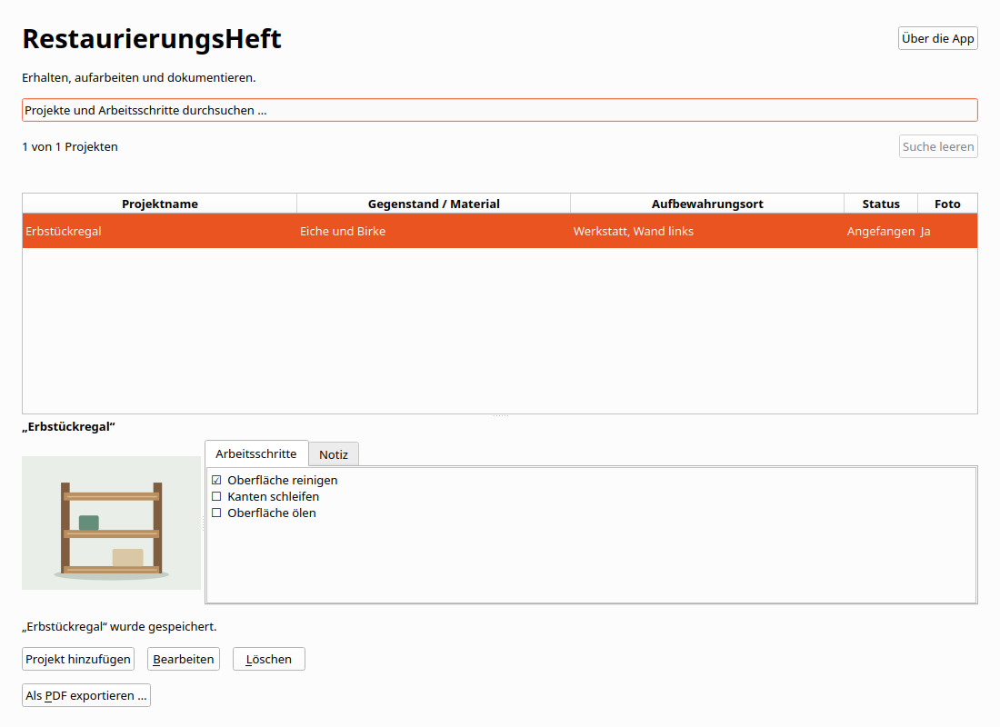

# Restoration Journal

## Linux-Anwendungsmenü und Dock

Nach dem Entwicklungsbuild registriert dieser Befehl die App im aktuellen
Benutzerkonto:

```bash
python3 scripts/install_desktop.py --development
```

Danach erscheint **Restoration Journal** mit dem eigenen Icon im Anwendungsmenü und Dock.
Der Menüeintrag startet den vorhandenen Entwicklungsbuild über
`scripts/launch.sh`. Dieser baut nichts neu. `scripts/run.sh` baut weiterhin
und startet anschließend die App. Bei fehlendem Build zeigt der Starthelfer
eine Fehlermeldung auf stderr.

Der Installer schreibt ausschließlich den eigenen Desktop-Eintrag und Icons
unter `$XDG_DATA_HOME`, standardmäßig `~/.local/share`. Wiederholtes Ausführen
aktualisiert verwaltete Einträge. Fremde Einträge werden nicht überschrieben.
Die normale Sammlung und Spracheinstellung bleiben erhalten.
`--data-dir /absoluter/testpfad` ist nur für einen ausdrücklich gewünschten
abweichenden Startpfad nötig.

Ein eigenständiges Linux-Paket enthält denselben Installer. Im Paketordner
genügt `python3 install_desktop.py`. Alternativ ist
`python3 scripts/install_desktop.py --app-dir /absoluter/paketpfad` möglich.
Dabei verweist der Menüeintrag auf `RestorationJournal.sh` und die paketierte Laufzeit.

Die bestehenden Motive bleiben unverändert. Zusätzliche PNG-Größen können
mit `python3 scripts/prepare_icons.py` erzeugt werden. Dafür ist Python mit
Pillow erforderlich, für Installation und App-Start nicht.

## Sammlung, Information und Sprache

Hinzufügen steht oben rechts. Unter der Tabelle stehen Bearbeiten und Löschen.
Die Spaltenüberschriften sortieren auf- und absteigend. Textspalten verwenden die
aktuelle Sprache und eine natürliche Zahlenreihenfolge. Status folgt der Reihenfolge
geplant, angefangen, fertig. Die Auswahl bleibt erhalten.

Info enthält getrennte Fenster für Über die App, Datenschutz und Lizenzen.
Alle Inhalte sind offline verfügbar. Neue Installationen verwenden die unterstützte
Systemsprache mit Englisch als Fallback. Gespeicherte Sprachwahlen bleiben erhalten.

Exportieren sichert die gesamte gespeicherte Sammlung als JSON mit eingebetteten
Originalfotos und allen vorhandenen Status- und Checklistendaten. Importieren ergänzt
fehlende Exemplare nach Bestätigung. Vorhandene Einträge werden nicht überschrieben.
Erneuter Import derselben Datei legt keine zusätzlichen identischen Exemplare an.
Exportdateien enthalten keine Spracheinstellung oder internen Eintrags-IDs.
Schrittkennungen, Reihenfolge und Erledigungsstand werden bei vorhandenen Checklisten
mitgesichert. Kollidierende Schrittkennungen werden beim Hinzufügen neu vergeben.

Eine Transferdatei darf höchstens 256 MiB und 10.000 Einträge enthalten.
Die bisherigen Fotogrenzen bleiben bestehen. Maximal 10.000 Schritte je Projekt
und eine Million Zeichen je Textfeld. Die Grenze verändert vorhandene Daten nicht.
Ein unvollständiger Import wird niemals gespeichert. Dateien anderer Apps und
unbekannte Formatversionen werden abgewiesen. JSON-Dateien sind nicht verschlüsselt.

Auf macOS wählst du erst einen Ordner und dann einen Dateinamen. Auf anderen
Plattformen öffnet sich der Speicherdialog. Vorhandene Dateien werden erst nach
Bestätigung und erneuter Prüfung ersetzt. Datenträger ohne Hardlinks werden für
neue Dateien unterstützt. Bei hartem Abbruch kann dort eine unvollständige neue
Datei zurückbleiben. Erstelle den Export dann erneut unter einem neuen Namen.


Erhalten, aufarbeiten und dokumentieren. Verwalte kleine private
Restaurierungsprojekte mit Projektname, Gegenstand oder Material, Aufbewahrungsort, mehrzeiliger
Notiz, einem optionalen Foto, Projektstatus, einer Checkliste und PDF-Export.
Alles bleibt lokal, ohne Konto und Internet.



Version 0.1.0 ist die fünfte kleine C++-App des Hobby-Portfolios und ein
nachvollziehbares Bewerbungsprojekt. Gegenüber HolzwerkProjekt kommt genau eine
Hauptfunktion hinzu: PDF-Export. Am 28. Oktober 2026 wurde die frühere Reserve
ausdrücklich beauftragt. Veröffentlichungsziele sind ausdrücklich
**zuerst Microsoft Store, später Mac App Store für Mac-Computer**.
Es wurde nichts veröffentlicht oder bei einem Store eingereicht.

## Entwickeln und starten

C++20, Qt 6.8.3 Widgets, CMake ab 3.25, Ninja, Qt SQL mit QSQLITE und Qt Test.
Lokal verwendete Kombination: Ubuntu 24.04.4 x64, GCC 13.3.0, CMake 4.4.4,
Ninja 1.11.1, clang-format 23.1.3 und clang-tidy 22.1.8. Alle Qt-Komponenten und
Plugins müssen zum selben SDK und zur Compiler-ABI gehören. Qt wird dynamisch
unter der gewählten kostenfreien LGPL-Basis eingebunden.

Linux und macOS:

```bash
export RESTAURIERUNGSHEFT_QT_ROOT=/absoluter/pfad/Qt/6.8.3/gcc_64
source scripts/env.sh
cmake --preset dev
cmake --build --preset dev --parallel 4
bash scripts/run.sh --data-dir /tmp/restaurierungsheft-test
```

Unter Linux öffnet `build/dev/restaurierungsheft` die normale eigene Sammlung.
Für native Linux-Dateidialoge `QT_QPA_PLATFORMTHEME=gtk3` verwenden.
Wenn der Plattformhelfer fehlt, stellt Qt seinen Dateidialog bereit.
Windows und macOS verwenden ihre Systemdialoge.
Auf macOS zeigt der SDK-Pfad auf `macos`. Der Launcher befindet sich unter
`build/dev/restaurierungsheft.app/Contents/MacOS/restaurierungsheft`.

Windows in einer x64-Developer-PowerShell von Visual Studio 2022:

```powershell
$env:RESTAURIERUNGSHEFT_QT_ROOT = 'C:\Qt\6.8.3\msvc2022_64'
$env:CMAKE_PREFIX_PATH = $env:RESTAURIERUNGSHEFT_QT_ROOT
$env:PATH = (Join-Path $env:RESTAURIERUNGSHEFT_QT_ROOT 'bin') + [IO.Path]::PathSeparator + $env:PATH
cmake --preset dev
cmake --build --preset dev --parallel 4
.\build\dev\restaurierungsheft.exe
```

`.tools/env.sh` darf lokale Werkzeugpfade enthalten und ist ignoriert.
Ein vorhandenes Qt-SDK kann zur Entwicklung mehrerer Apps dienen.
Die fertige App hat eigene Quellen, Git-Historie, Daten und Laufzeitpakete.
Es gibt keine gemeinsame Runtime oder Datenübernahme anderer Portfolio-Apps.

## Bedienung

„Projekt hinzufügen“ und „Bearbeiten“ öffnen denselben Dialog.
Nur der Projektname ist erforderlich. Neue Projekte sind **Geplant** und
haben weder Foto noch Arbeitsschritte. Gleichnamige Projekte sind unabhängig.
Bearbeiten und Löschen verwenden interne IDs. Löschen verlangt eine Bestätigung
und entfernt nur das gewählte Projekt einschließlich Foto und Arbeitsschritten.

Die Statusauswahl hat genau drei Werte: **Geplant**, **Angefangen**, **Fertig**.
Alle Wechsel sind direkt und in beide Richtungen erlaubt. Der Status verändert
keine Häkchen. Alle Schritte abzuhaken setzt den Status nicht automatisch auf
Fertig. Ein fertiges Projekt darf offene Schritte oder eine leere Checkliste haben.

„Arbeitsschritt hinzufügen“ hängt eine neue offene Zeile an. Text direkt eingeben
oder umbenennen, Kästchen abhaken oder wieder öffnen und Zeilen entfernen.
Jede Zeile besitzt bereits im Entwurf eine stabile UUID. Gleichlautende Texte
sind erlaubt. Entfernen erhält Reihenfolge und IDs der übrigen Schritte.
Leere oder nur aus Unicode-Leerraum bestehende Schritttexte müssen vor Speichern
korrigiert oder entfernt werden. Die Fehlermeldung nennt die betroffene Zeile.
Alle Eingaben bleiben erhalten. Eine vollständig leere Checkliste ist gültig.

**Erst Speichern übernimmt Texte, Foto, Status und Schritte gemeinsam.**
Abbrechen, Escape und Fensterschließen schützen auch reine Foto-, Status- oder
Häkchenänderungen. „Weiterbearbeiten“ ist die sichere Vorauswahl.
Ein Speicherfehler erhält den vollständigen Entwurf und erlaubt einen erneuten
Versuch. Während Import und Speichern sind konkurrierende Aktionen gesperrt.
Unveränderte oder vollständig zurückgesetzte Entwürfe schließen ohne Rückfrage.

Die Hauptansicht zeigt das gespeicherte Foto sowie die lesenden Register
„Arbeitsschritte“ und „Notiz“. Die vollständige Notiz bleibt scrollbar.
Die Suche erfasst alle vier Projekttextfelder und sämtliche Schritttexte.
Sie berücksichtigt Groß- und Kleinschreibung, Umlaute sowie zusammengesetzte
und zerlegte Unicode-Schreibweisen. Mehrere passende Schritte ergeben nur einen
Projekttreffer. Eine leere Suche zeigt alles. Nach Speichern außerhalb der
aktuellen Suche erklärt ein Hinweis, wo der gespeicherte Eintrag zu finden ist.

## Ein Foto

Die native Dateiauswahl erlaubt genau ein JPEG oder PNG. Hinzufügen, Ersetzen
und Entfernen betreffen zunächst den Entwurf. Die App prüft den tatsächlichen
Inhalt und decodiert das Bild vollständig. Abbruch und Importfehler erhalten den
vorigen Stand. Die Originaldatei wird nie verändert oder gelöscht.
Eine eigene Kopie der Bytes liegt in SQLite. Das Foto bleibt nach Entfernen der
Quelle und nach Neustart verfügbar.

Grenzen: **10 MiB**, **6000 Pixel je Seite**, **16 Millionen Pixel insgesamt**.
Animierte PNG-Dateien werden abgewiesen. Die proportionale Vorschau berücksichtigt
vom Qt-Decoder unterstützte Orientierung. Besondere Farbprofile werden nicht
zusätzlich aufbereitet. Keine Galerie, Bildbearbeitung, OCR oder Bilderkennung.

## Ein Projekt oder die gesamte Sammlung als PDF

„Als PDF exportieren …“ öffnet im Hauptfenster ein Menü mit „Ausgewähltes Projekt …“
und „Alle Projekte …“. Strg+Umschalt+E / Cmd+Umschalt+E exportiert weiterhin das
gewählte Projekt. Ohne Auswahl bleibt nur der Einzelprojekt-Export deaktiviert.
Der Gesamtexport umfasst alle gespeicherten Projekte, unabhängig vom Suchfilter,
und ordnet sie alphabetisch in der App-Sprache. Jedes Projekt beginnt auf einer
neuen Seite. Eine leere Sammlung kann nicht als PDF exportiert werden.

Die vorgeschlagenen Dateinamen enthalten wie beim JSON-Export das lokale Datum
und die Uhrzeit im Format `yyyy-MM-dd_HH-mm-ss`. Für alle Projekte lautet der
Vorschlag `restoration-journal-2026-11-01_22-00-00.pdf`. Beim Einzelprojekt steht
der bereinigte Projektname vor dem Zeitstempel. Der Name bleibt frei änderbar.

Während der App-Sitzung öffnen beide PDF-Aktionen den Ordner des letzten
erfolgreichen PDF-Exports. Abgebrochene oder fehlgeschlagene Exporte verändern
diesen Ordner nicht. Fehlt er inzwischen, beginnt die Auswahl im Dokumente-Ordner.

Die PDFs verwenden denselben Aufbau wie Costume Planner: Titel und farbige
Statuskarte, Angaben links neben dem proportionalen Foto, echte Farbkachel mit
Hexcode, Notiz und farbige Karten für die Arbeitsschritte. Lange Angaben erscheinen
untereinander. Ein Zähler und ein Fortschrittsbalken zeigen erledigte Schritte.
Offen und Erledigt sind durch Text und Häkchen auch ohne Farbe eindeutig.
Lange Texte und Arbeitsschritte werden vollständig über weitere Seiten fortgesetzt.
Kopf- und Fußbereich enthalten Restoration Journal und Seite-von-Gesamt-Angaben.

Die PDF enthält ausschließlich gespeicherte Daten einschließlich Originalfoto,
Status, Farbe und aller Arbeitsschritte. Im Editor gibt es keine Exportaktion.
Zwei Layout-Durchläufe bestimmen zuerst die Seitenzahl und schreiben anschließend
das Dokument. Für den Gesamtexport bleiben beide Durchläufe in derselben
SQLite-Lesetransaktion. Es wird jeweils nur ein vollständiges Foto geladen.
DejaVu Sans 2.37 in Regular und Bold ist in der App und in den PDFs eingebettet.
Fehlende Zeichen werden vor Dateiübernahme gemeldet, ohne gespeicherte Daten zu ändern.

Auf macOS wählst du einen Zielordner und danach den Dateinamen. Auf anderen
Plattformen öffnet sich der native Speicherdialog. Abbrechen verändert keine
Dateien. Bestehende PDFs werden nur nach ausdrücklicher Bestätigung und erneuter
Zielprüfung atomar ersetzt. Neue Dateien können auch ohne Hardlinks exklusiv
angelegt werden. Nach hartem Abbruch kann dabei eine unvollständige neue Datei
zurückbleiben. Wähle einen eigenen Ordner außerhalb des App-Datenverzeichnisses.

Der Export läuft im Hintergrund. Suchen und Lesen bleiben möglich. Bearbeiten,
Löschen, weitere Exporte und Schließen warten bis zum Abschluss. Fehler erhalten
vorhandene Dateien und erlauben einen erneuten Versuch. Temporäre Dateien liegen
im gewählten Zielordner und werden nach Möglichkeit aufgeräumt. Die technischen
Grenzen stehen in [Architektur](docs/architecture.md). Es gibt keinen PDF-Viewer
in der App. Native Windows- und macOS-Abnahmen bleiben erforderlich.

## Tastatur und kleine Fenster

| Taste | Aktion |
| --- | --- |
| Strg+N / Cmd+N | Projekt hinzufügen |
| Strg+F / Cmd+F | Suche auswählen |
| Enter oder Doppelklick in der Projektliste | Bearbeiten |
| Entf in der Liste, Cmd+Rücktaste auf macOS | Löschbestätigung |
| Strg+S / Cmd+S | Gesamten Dialog speichern |
| Escape | Dialogabbruch mit Verwerfschutz |
| Enter im Notizfeld | Neue Zeile |
| Leertaste auf einem Kästchen | Abhaken oder wieder öffnen |
| Leertaste auf einer Schrittaktion | Hinzufügen oder Entfernen |
| Tab / Umschalt+Tab | Nächstes / vorheriges Bedienelement |

Unter Linux und Windows fokussiert Alt+C die Checkliste, Alt+Z ergänzt eine Zeile.
Alt+P, Alt+M, Alt+A, Alt+S und Alt+N führen zu Projektname, Material, Ort, Status und
Notiz. Alt+F öffnet die Fotoauswahl. Das Formular scrollt auch bei vielen Schritten
und vergrößerter Schrift. Speichern und Abbrechen bleiben außerhalb des Scrollbereichs.

## Lokale Daten und Sicherung

App-Kennung: `de.appfabrik.restaurierungsheft`.
`restaurierungsheft.sqlite3` enthält Projekte, Fotobytes und Schritte.
QStandardPaths ermittelt das eigene Benutzerverzeichnis. „Über die App“ zeigt den
tatsächlich verwendeten Pfad. Typische Pfade ohne Store-Sandbox:

| System | Verzeichnis |
| --- | --- |
| Linux, hier geprüft | `$XDG_DATA_HOME/de.appfabrik.restaurierungsheft`, sonst `~/.local/share/de.appfabrik.restaurierungsheft` |
| Windows, nativ noch zu prüfen | `%LOCALAPPDATA%\de.appfabrik.restaurierungsheft` |
| macOS, nativ noch zu prüfen | `~/Library/Application Support/de.appfabrik.restaurierungsheft` |

Sandbox und Paketvirtualisierung können diese Pfade ändern.
Nutzerdaten liegen außerhalb des Programm- und Quellverzeichnisses.
Zum manuellen Sichern die App schließen und die SQLite-Datei kopieren.
`collection.lock` ist keine Nutzerdatenbank. Eine zweite App-Instanz derselben
Sammlung wird abgewiesen. Andere eigenständige Apps können parallel laufen.
Externe gleichzeitige Datenbearbeitung wird nicht unterstützt.
SQLite kann freien Platz intern behalten. Eine sofortige Dateiverkleinerung
oder sichere physische Löschung entfernter Bilder wird nicht zugesagt.

`--data-dir` muss absolut und nicht leer sein. Ungültige Pfade fallen niemals
auf normale Benutzerdaten zurück. Tests verwenden nur temporäre Datenbanken
und synthetische Bilder.

## Prüfen und verstehen

Für die PDF-Prüfungen werden die Poppler-Werkzeuge `pdftotext`, `pdfinfo`,
`pdffonts`, `pdfimages` und `pdftoppm` im PATH benötigt. Sie gehören nur zur
Entwicklungsumgebung und nicht zur ausgelieferten App.


```bash
source scripts/env.sh
bash scripts/check.sh
ASAN_OPTIONS=detect_leaks=1:halt_on_error=1 UBSAN_OPTIONS=halt_on_error=1 bash scripts/check.sh asan
DISPLAY=:0 python3 scripts/gui_smoke.py --binary build/dev/restaurierungsheft --output build/manual/dev-visible
```

Bei unzuverlässiger Desktop-Eingabe bietet `scripts/visible_desktop.py` einen
eigenen sichtbaren Xephyr mit Openbox. Aufruf und Nachweise stehen im Prüfbericht.

Der sichtbare Helfer hält auf DISPLAY=:0 automatisch die gemeinsame UI-Sperre
und bedient nur selbst gestartete Fenster. [Prüfbericht](docs/verification.md),
[Architektur und Interviewerklärung](docs/architecture.md),
[Paketierung](docs/packaging.md) und [Lizenzhinweise](THIRD_PARTY_NOTICES.md)
beschreiben Nachweise und Grenzen.

| Stufe | Eigenständige App | Neue Hauptfunktion |
| --- | --- | --- |
| 1 | BrettspielRegal | Anlegen, Bearbeiten, Löschen, Suchen |
| 2 | SammlerVitrine | Ein Foto |
| 3 | ModellbauProjekt | Projektstatus |
| 4 | HolzwerkProjekt | Checkliste |
| 5 | Restoration Journal | PDF-Export |

Jede Stufe behält die vorherigen Grundfunktionen. Restoration Journal ist die
beauftragte fünfte und letzte Stufe. FactoryForge und PDF Batch Studio bleiben
separate größere Projekte. Keine Kostenplanung, Werkzeugbestände, Fristen,
Unteraufgaben, Fortschrittswerte, PDF-Import, PDF-Editor, Druckfunktion oder Cloud.

## Sprachen und Store-Vorschau

Oberfläche und PDF-Ausgabe unterstützen Deutsch, Englisch, Spanisch, Französisch,
Italienisch und brasilianisches Portugiesisch. „Sprache“ oder Strg+, speichert
die Auswahl für den nächsten Start. Bestandsdaten und Projektumfang bleiben erhalten.
[Internationalisierung](docs/internationalization.md) beschreibt Store-Texte, echte
Linux-Aufnahmen, PDF-Nachweise und Lieferung als Ordner ohne Archiv.
Windows-Abnahme und Einreichung bleiben separat.

## JSON-Austauschformat

Formatkennung `restoration-journal.collection`, Version `1`, Eintragsliste `projects`.
Jeder Eintrag enthält `name`, `material`, `location`, `note` und `photoBase64`.
Ohne Foto ist `photoBase64` null, sonst enthält es die ursprünglichen Bildbytes
als kanonisches Base64. Interne Eintrags-IDs sind nicht Bestandteil des Formats.
Status wird als `status` mit `planned`, `started` oder `finished` gespeichert.
`steps` enthält `id`, `text`, `completed` und `position` je Arbeitsschritt.
Schrittpositionen müssen als JSON-Zahlen exakt darstellbar sein.
Dateien anderer Produkte, unbekannte Versionen und ungültige Felder werden
abgewiesen. Der bestätigte Import verwendet einen bereits validierten Snapshot.

## Optionale Farbauswahl

Wie in Yarn Box ab der zweiten Java-App besitzt jeder Eintrag eine optionale
Farbe. Im Editor öffnet „Farbe auswählen“ den Farbdialog mit Palette, eigener
Farbe und Transparenz. Erst Bestätigen übernimmt die Auswahl in den Entwurf.
„ד entfernt sie. Erst Speichern übernimmt den gesamten Entwurf in die Sammlung.
Abbrechen und Schließen schützen auch Änderungen ausschließlich an der Farbe.

Die Tabelle zeigt ein Farbfeld und den Hexcode. Sie lässt sich nach Farbe
sortieren. Auch die Suche berücksichtigt den Code. Transparenz ist am
Schachbrettmuster erkennbar. Die Auswahl ist in allen sechs Sprachen verfügbar.

Farben werden als `#RRGGBB`, bei Transparenz als `#RRGGBBAA` gespeichert.
Keine Farbe entspricht einer leeren Zeichenfolge. JSON-Exporte enthalten das
Feld `color`. Bisherige Exporte ohne dieses Feld bleiben importierbar.
Neue Exporte benötigen zum Import die aktualisierte App. Unterschiede in der
Farbe gelten beim ergänzenden Import als unterschiedliche Einträge.

Vorhandene lokale Datenbanken werden nach Prüfung ihrer Identität und Struktur
atomar von Schema 1 auf Schema 2 erweitert. IDs, Texte, Originalfotos und alle
vorhandenen Status- und Checklistendaten bleiben erhalten. Die Farbauswahl ist
zunächst leer. Ältere App-Builds können Schema 2 nicht öffnen.

Der vorhandene PDF-Export zeigt die gespeicherte Farbe als Farbkachel mit
Schachbrettmuster bei Transparenz und lesbarem Hexcode.
