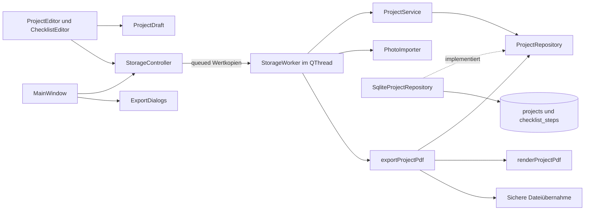

# Architektur und Bewerbungsgespräch

Ein CMake-Projekt mit fünf kleinen internen Targets trennt Modell/Service,
Fotoimport, SQLite und Oberfläche. Qt Core-Werttypen sind erlaubt.
Repository-Vertrag und Fachlogik kennen keine Widgets, SQL bleibt in der
Persistenz. Es gibt weder Plugin-Architektur noch gemeinsamen Portfolio-Core.
HolzwerkProjekt, Commit `6940968`, ist die geprüfte Grundlage. CRUD, Fotos,
Status und Checkliste wurden app-lokal angepasst. KostümPlan diente nur als
fachliches Vorbild für PDF-Bedienung, Dateien und Prüfungen. Es gibt keine
Java-Laufzeit oder Abhängigkeit auf andere Portfolio-Apps.

## Identität und Werte

`RestorationProject` trägt eine 64-Bit-Projekt-ID. SQLite erzeugt sie mit
`INTEGER PRIMARY KEY AUTOINCREMENT`. Gleiche Namen dürfen vorkommen.
Mutationen verwenden die ID und niemals Namen oder sichtbaren Listenindex.
`ProjectDraft` enthält vier QString-Werte, Status, Fotobytes und eine Liste von
`ChecklistStep`. Leere Fotobytes bedeuten kein Foto.

Ein Schritt enthält `QUuid id`, `QString text`, `bool completed` und
`qint64 position`. Die UUID entsteht beim Hinzufügen zum Entwurf.
Umbenennen, Abhaken und Speichern erhalten sie. UI-Callbacks entfernen über die
gefangene UUID. Nach Entfernen einer mittleren Zeile wirken Aktionen deshalb
weiter auf den richtigen Schritt. Gleiche Texte sind unabhängig.

**Positionslücken bleiben bestehen.** Neue Zeilen erhalten die Position hinter
der letzten verbleibenden Zeile. Positionen sind streng aufsteigend,
nicht negativ und pro Projekt eindeutig. Entfernen ändert keine IDs oder
Positionen der übrigen Zeilen. Es gibt keine manuelle Umsortierung.

| enum class ProjectStatus | Speicherwert | Anzeige |
| --- | --- | --- |
| Planned | planned | Geplant |
| Started | started | Angefangen |
| Finished | finished | Fertig |

Die Funktionen `storedStatus`, `statusFromStorage` und `displayStatus` ordnen
explizit zu. Implizite Enum-Reihenfolge und Übersetzungen gelangen nicht in SQLite.
Ungültige Werte werfen verständliche Fehler. Die ComboBox ist nicht editierbar.
Neue Projekte sind Planned. Jede Änderung ist frei, ohne Abhängigkeit zu Häkchen.

Einzeilige Projektfelder werden außen getrimmt. Schritttexte müssen zusätzlich
einzeilig und nach Unicode-Trim nicht leer sein. Die Notiz wird nicht getrimmt.
Der Qt-Klartexteditor verwendet LF-Zeilenumbrüche. Suche normalisiert nach NFC,
wendet Unicode-Case-Folding und erneut NFC an. Das gilt für sämtliche Projekt-
und Schritttexte. Ein deutscher QCollator mit natürlicher Zahlensortierung und
ID als Gleichstandsregel liefert eine stabile Reihenfolge. Jedes Projekt wird
höchstens einmal übernommen, wenn irgendein Feld oder Schritt passt.

## Ein gemeinsamer Entwurf

Der Editor hält den Ausgangswert und die aktuellen rohen Werte.
Neue Schritttexte dürfen während der Eingabe leer sein. Erst Speichern validiert
alle Werte. Bei Fehler bleiben Texte, Häkchen, UUIDs, Positionen, Status und
Fotoentwurf erhalten. Die Meldung nennt die sichtbare Schrittzeile.

Wertgleichheit vergleicht alle Felder, einschließlich Fotobytes und Schrittliste.
Sie schützt reine Häkchenänderungen genauso wie Text-, Status- und Fotoänderungen.
Ein gleicher Dateiname ist unerheblich. Wird der gesamte Wert wiederhergestellt,
entfällt die Rückfrage. Abbrechen, Escape, Dialogschließen und Hauptfensterschließen
verwenden denselben Verwerfschutz mit „Weiterbearbeiten“ als Standard und Escape-Aktion.

Der Hauptbereich zeigt ausschließlich gespeicherte, lesende Daten.
Es gibt keine zweite Checklistenbearbeitung oder sofortige Häkchenspeicherung.
Die scrollbare Dialogform hält Fotoaktionen und viele Schritte erreichbar.
Die Dialogschaltflächen liegen außerhalb des Scrollbereichs.

## Transaktion über zwei Tabellen

Schema 2 und die eigene SQLite-`application_id=1380471857` kennzeichnen die Datei.
`projects` enthält Texte, Status und optionalen Foto-BLOB.
`checklist_steps` besitzt UUID-Primärschlüssel, `project_id` als Fremdschlüssel,
Text, Boolean als INTEGER 0/1 und explizite Position.
NOT NULL, CHECK, UNIQUE und ON DELETE CASCADE schützen die Wertebereiche.
Jede Repository-Verbindung aktiviert und kontrolliert `PRAGMA foreign_keys=ON`.

Ein Speichervorgang auf derselben Verbindung:

1. Entwurf und vollständige Bildbytes validieren.
2. Eine explizite SQLite-Transaktion beginnen.
3. Projektzeile anlegen oder per ID ändern.
4. Bisherige Schrittzeilen dieses Projekts entfernen.
5. Vollständige kleine Schrittliste mit unveränderten UUIDs einfügen.
6. Commit abschließen und erst jetzt den bestätigten Datensatz zurückmelden.

Die vollständige Ersetzung der kleinen Liste ist absichtlich einfach.
Ein RAII-`Transaction` rollt jeden vorzeitigen Ausgang zurück, auch wenn ein
späteres INSERT oder erst der Commit scheitert. Die Tests legen einen echten
SQLite-Trigger auf den zweiten Schritt-INSERT. Sie belegen den Rollback aller
Projektfelder, Fotobytes, Statuswerte und Schritte. Ein fehlgeschlagenes Anlegen
hinterlässt weder Projekt- noch Schrittteilzeilen. Nach Entfernen des Triggers
gelingt derselbe Entwurf. Ein bloßer vorgezogener Mockfehler würde das nicht beweisen.

Parametrisierte SQL-Anweisungen binden auch Schritttexte und UUIDs.
Anführungszeichen und SQL-ähnliche Texte bleiben Daten.
Projektlöschung entfernt Foto und Schritte atomar per Fremdschlüssel-Kaskade.
Andere gleichnamige Projekte bleiben erhalten.

Listen- und Detailabfrage lesen Projektzeilen und Schritte in einer gemeinsamen
Lesetransaktion. Listen enthalten keine Fotobytes, nur eine Foto-Kennzeichnung.
Die Auswahl lädt den vollständigen Stand bedarfsgerecht. Auch ohne Foto wird vor
Bearbeitung eine konsistente Detailabfrage durchgeführt. Ein Foto- oder Lesefehler
öffnet keinen leeren Ersatzentwurf. Unbekannte Statuswerte, beschädigte Schrittwerte,
UUIDs und Reihenfolgen werden gemeldet und nicht still repariert.

Vorhandene leere, beschädigte, fremde und neuere Datenbanken werden abgewiesen.
App-ID, exakte bekannte Tabellenstruktur, Integritäts- und Fremdschlüsselprüfung
sichern das Öffnen ab. Die Datei wird nicht durch eine leere Sammlung ersetzt.
Ein QLockFile im kanonischen Datenverzeichnis verhindert eine zweite App-Instanz.
Externe gleichzeitige Bearbeitung ist kein unterstützter Ablauf.

## Fotoimport und begrenzte Speicherbelegung

Die native Dateiauswahl liefert einen nur vorübergehend benötigten Pfad.
Der Import öffnet ausschließlich lesend und liest höchstens 10 MiB plus ein
Prüfbyte in Blöcken. Nachträgliches Dateiwachstum umgeht die Grenze nicht.
QImageReader erkennt den Inhalt. Nur JPEG und PNG sind zulässig.
Abmessungen werden vor vollständigem Decodieren geprüft: 6000 Pixel je Seite,
16 Millionen Pixel insgesamt. Das Pixelprodukt wird mit 64 Bit berechnet.

PNG-Chunklängen, CRCs und IEND werden zusätzlich geprüft. Animierte PNGs werden
abgewiesen. JPEG benötigt vollständige Einrahmung. Ein mutexgeschützter
Diagnose-Scope behandelt Decoderwarnungen im aktuellen Thread als Importfehler,
weil der JPEG-Decoder manche Beschädigungen sonst repariert. Andere Meldungen
werden an den vorherigen Qt-Handler weitergegeben. Die App installiert keine
konkurrierenden Diagnose-Handler.

Erst vollständige erfolgreiche Decodierung erzeugt eine QImage-Vorschau bis
1000 Pixel je Seite. Die Originalbytes bleiben unverändert im BLOB.
`setAutoTransform(true)` berücksichtigt unterstützte EXIF-Orientierung.
Die GUI stellt proportional dar und erzeugt QPixmap nur im GUI-Thread.
Ein 16-Megapixel-Bild benötigt etwa 64 MiB bei 32 Bit oder 128 MiB bei 64 Bit
pro Pixel, zuzüglich Decoderpuffern und Vorschau. Qt kann wegen seines eigenen
Allokationslimits früher ablehnen. Es gibt keine zusätzliche Farbprofilaufbereitung
und keine Decoder-Sandbox. Bildinhalte werden nicht semantisch geprüft.

## RAII, Besitz und Threads

Qt-Parent-Ownership verwaltet Widgets. `MainWindow` hält den Editor als QPointer.
`StorageController` besitzt einen QThread. Der Worker wird vor Arbeitsbeginn
dorthin verschoben und am Threadende im eigenen Thread freigegeben.
Er besitzt das Repository mit `std::unique_ptr`. Die SQL-Verbindung entsteht,
arbeitet und endet ausschließlich im Worker. Lokale QSqlQuery-Werte geben
Abfragen zuverlässig frei. Beim Abbau verschwinden Handles vor dem Entfernen
der benannten Qt-Verbindung.

Ein Worker ordnet Datenbank-, Import- und Decoderaufgaben seriell.
Die auf zwei Sekunden begrenzte SQLite-Sperrwartezeit blockiert keine Widgets.
Queued Signale transportieren Wertkopien. QString und QByteArray verwenden
Copy-on-write. Konstante Referenzen dienen zum Lesen innerhalb einer Schicht.
Doppelaktionen während Import und Speichern bleiben gesperrt.

Jeder Auswahlwechsel erhöht einen Generationstoken. Ein verspätetes Ergebnis
wird nur übernommen, wenn Token und Projekt-ID noch passen. Empfänger-Kontexte
trennen Signale automatisch bei Fensterzerstörung. Ein verworfener Editor hat
keine wirksamen Importcallbacks mehr. Ein neuer Editor übernimmt keine fremden
späten Ergebnisse. Der Controller beendet seinen Thread geordnet.
Sehr schnelle Auswahlwechsel können die serielle Warteschlange verlängern.
Für kleine private Sammlungen ist das der bewusst überschaubare Ansatz.

## Gespeicherter PDF-Snapshot und Oberfläche

Die Oberfläche hält die gewählte Projekt-ID vor der nativen Dateiauswahl fest.
`StorageController` sperrt den Vorgang von der Zielprüfung bis zum Abschluss.
Ein Auswahlwechsel verändert diese ID nicht. Der einzige bestehende Worker
führt Zielprüfung, SQL-Lesen, Decodierung, Rendern und Dateiübernahme aus.
Es entsteht weder eine zweite Jobplattform noch eine threadfremde SQL-Verbindung.
Native Dialoge und Bestätigungen bleiben im GUI-Thread.

`ProjectRepository::find(id)` liefert in einer Lesetransaktion den vollständigen
Wert aus Projektzeile und geordneten Schrittzeilen. Der Exportdienst hat keinen
Datenbankschreibpfad. Ein zuvor in der Liste angezeigter Stand wird nicht als
Exportquelle verwendet. Der Renderer erhält nur diesen Wert und ein QIODevice.
Er kennt keine Widgets, SQL-Verbindungen oder Dateidialoge.

Das PDF-Menü ergänzt alle gespeicherten Projekte. ID 0 bezeichnet ausschließlich
an der UI-/Worker-Grenze diesen Auftrag, gespeicherte IDs bleiben positiv.
`withSavedProjects` stellt dem Renderer eine wiederholbar lesbare Quelle bereit.
SQLite ordnet die IDs über die vorhandene sprachabhängige Sortierung und hält
während beider Durchläufe dieselbe Lesetransaktion. Vollständige Fotos werden
projektweise geladen. Ein anderer Repository-Typ kann einen unveränderlichen
Snapshot liefern. Die Quelle darf nicht über den Consumer-Aufruf hinausleben.

Während einer PDF bleiben Suche und Anzeige ansprechbar. Konkurrierende
Mutationen und weitere Exporte sind deaktiviert. Schließen wird mit Hinweis
zurückgestellt, danach kann das Fenster erneut geschlossen werden. Queued
Verbindungen mit Empfängerkontext verhindern Zugriffe auf zerstörte Fenster.
Der Controller wartet bei seinem Abbau auf das geordnete Ende des Workers.

## PDF-Layout und Schrift

`QPdfWriter` und `QPainter` aus dem bereits verwendeten Qt Gui schreiben A4 im
Hochformat mit 72 dpi Layoutkoordinaten. Ränder von 48 Punkt, ein eigener
Kopfbereich und Seitenzahlen unterhalb des Inhalts halten Text und Foto getrennt.
`QTextLayout` misst die tatsächlichen Zeichen mit DejaVu Sans und bricht bevorzugt
an Wortgrenzen um. `WrapAtWordBoundaryOrAnywhere` zerlegt auch überlange Wörter.
Jede einzelne Textzeile prüft vor dem Zeichnen den verfügbaren Seitenraum.
Auch ein Schritt mit mehreren Seiten wird dadurch vollständig fortgesetzt.
Überschriften reservieren Platz für die erste Inhaltszeile.

Notizen behalten Leerzeilen und explizite Umbrüche. CRLF, CR und Unicode-
Zeilentrenner werden für das Layout auf LF abgebildet, Tabulatoren auf vier
Leerzeichen und Texte auf NFC. SQLite-Werte bleiben unverändert. Kein HTML
wird interpretiert. URLs und Dateiverweise sind gewöhnlicher Text, ohne externe
Ladevorgänge. Fotos werden vollständig geprüft und proportional in einen Bereich
neben den Angaben gesetzt. Bei langen Angaben steht das Foto in einer eigenen
Karte mit höchstens 479 × 175 Punkt. Das Seitenverhältnis bleibt erhalten.
Die Bildquelle ist ausschließlich der gespeicherte BLOB.

Die Karten übernehmen Farben und Geometrie von Costume Planner. Titel, Status,
Angaben und Foto, Notiz und Arbeitsschritte erscheinen in dieser Reihenfolge.
Die Farbkachel zeichnet Transparenz auf einem Schachbrett. Schrittzähler,
Fortschrittsbalken und farbige Schrittkarten ergänzen die lesbaren Zustände.
Die erste Messung verwendet dieselben Umbruch- und Platzierungsfunktionen ohne
Zeichenausgabe. Der zweite Durchlauf schreibt Seite-von-Gesamt-Fußzeilen.
Jedes Projekt beginnt auf einer neuen Seite. Eine leere Quelle ist ein Fehler.

DejaVu Sans 2.37 in Regular und Bold sowie die unveränderte Noto Emoji 3.002 liegen
als Qt-Ressourcen in der App und werden vor Workerstart registriert. Der Renderer
erkennt vollständige Grapheme mit QTextBoundaryFinder. Emoji-Grapheme erhalten
eine explizite QTextLayout-Formatierung mit Noto Emoji in normaler Schriftstärke.
Hautfarben, Flaggen, Variation-Selektoren und ZWJ-Sequenzen bleiben dabei zusammen.
Messung, Zeilenumbruch und Zeichnung verwenden dieselben Schriftzuweisungen.
Die Symbole werden einfarbig als eingebettete Schrift ausgegeben. Systemschriften
und insbesondere plattformspezifische Farbschriften sind nicht erforderlich.

QRawFont prüft beide Schriftarten. Übrige fehlende Zeichen sowie Steuerzeichen
außerhalb einer Emoji-Sequenz erscheinen ausdrücklich als `[U+XXXX]`. Das bewahrt
ihre Codepoints in einer lesbaren Ersatznotation und blockiert keine Sammlung.
SQLite und JSON behalten die Originaltexte. Ungültige UTF-16-Surrogate bleiben
ein Fehler vor Dateiübernahme. Poppler prüft Text, eingebettete Schriften und
Unicode-Zuordnung. Eine Zusage für beliebige komplexe Schreibrichtungen gibt es nicht.
Qt 6.8 erstellt seine PDF-Unicode-Zuordnung nur für BMP-Codepoints. Deshalb sind
die Emoji-Konturen sichtbar und druckbar, außerhalb des BMP und bei Ligaturen
aber nicht zuverlässig als Originaltext aus der PDF extrahierbar. Die Prüfung
kontrolliert diese Symbole zusätzlich im unabhängigen Poppler-Rasterbild.
Originaltexte bleiben in SQLite und im JSON-Export vollständig erhalten.
Referenz: https://github.com/qt/qtbase/blob/v6.8.3/src/gui/text/qfontsubset.cpp#L148

QPainter wird ausdrücklich beendet, anschließend endet QPdfWriter, danach wird
die Datei gespült und geschlossen. Lokale Werte sorgen auch bei Exceptions für
diese Lebensdauerreihenfolge. Erst danach beginnt die sichere Dateiübernahme.
Der Code verwendet ausschließlich gegen die installierten 6.8.3-Header gebaute
APIs. Die Online-Dokumentation der Reihe 6.8 zeigt inzwischen auch neuere Patches.

## Sichere Exportdateien

Der vorgeschlagene Name wird Unicode-normalisiert, um problematische Zeichen
bereinigt und auf 160 UTF-8-Bytes vor `.pdf` begrenzt. Windows-Gerätenamen werden
entschärft, leere Ergebnisse erhalten einen neutralen Namen. Die Zielprüfung
verlangt einen absoluten PDF-Pfad, einen vorhandenen beschreibbaren Ordner und
gegebenenfalls eine normale lesbare und beschreibbare Datei. Symlinks und
Windows-Reparse-Points werden abgelehnt. Das eigene Datenverzeichnis sowie
Hardlink-Aliasse eigener Datenbank-, Journal- und Sperrdateien sind geschützt.

Vor der Bestätigung erfasst der Worker den kanonischen Elternordner, dessen
Dateiidentität, Existenz, Dateiidentität, Änderungsmerkmale und SHA-256 des Ziels.
Er prüft diesen Stand vor Erzeugung und unmittelbar vor Veröffentlichung erneut.
Das erkennt auch Austausch mit gleichem Inhalt und gewöhnliche gleichzeitige
Änderungen. POSIX verwendet Geräte-/Inode-ID und Nanosekunden-Zeitmerkmale,
Windows Volume-/File-ID sowie Datei-Zeitmerkmale. Native Zielsystemtests bleiben offen.

QSaveFile wurde geprüft, sein direkter Schreibfallback wäre ausgeschaltet.
Ein reproduzierbarer Test zeigt aber, dass `commit()` eine inzwischen neu
erschienene Datei ersetzt. Deshalb verwendet dieser Export QTemporaryFile im
Zielordner. Nach vollständiger Erzeugung und Abschluss veröffentlicht ein
Hardlink ein zuvor nicht vorhandenes Ziel ohne Überschreiben. Diese Operation
scheitert atomar, falls dort selbst nach der letzten Prüfung eine Datei erscheint.
Ein bestätigtes vorhandenes Ziel wird auf POSIX mit atomarem `rename` und auf
Windows mit `MoveFileExW(MOVEFILE_REPLACE_EXISTING)` ersetzt. Kein Copy-Fallback.

QTemporaryFile entfernt den eigenen temporären Namen bei Erfolg und Fehlern,
soweit das Betriebssystem es zulässt. Fehlgeschlagene Render-, Schreib-, Flush-
und Übernahmeschritte verändern die zuvor vorhandene PDF nicht. Dateisperren
werden als Fehler behandelt. Unter Linux verhindert ein offener Leser den
atomaren Ersatz gewöhnlich nicht, Windows kann ihn verweigern.

Es gibt keine portable atomare Compare-and-swap-Operation für den Ersatz einer
bestehenden Datei. Zwischen letzter Prüfung und atomarem Ersatz bleibt ein
kleines Zeitfenster für fremde Prozesse. Böswilliges gleichzeitiges Umbenennen
von Elternordnern, gezielte Metadatenmanipulation und Stromausfalldauerhaftigkeit
werden nicht zugesichert. Der Schutz neuer Ziele ist atomar ohne Überschreiben.
Lokale Dateisysteme mit Hardlinks und atomarem Ersatz sind vorgesehen, keine
pauschale Zusage für FAT/exFAT, Netzwerkdateisysteme oder die spätere Mac-Sandbox.

## Im Bewerbungsgespräch

„Projekt und Checkliste sind eine Eins-zu-viele-Beziehung. Jedes Element hat
eine stabile Identität. Der Dialog ist ein vollständiger Wertentwurf. Eine
Transaktion speichert beide Tabellen, und ein echter später SQL-Fehler beweist
den Rollback. Status ist ein typisierter Wertebereich mit stabilen Schlüsseln.
Ein Worker hält SQLite und Decoder von Widgets getrennt. Generationstokens
verhindern, dass verspätete Fotos zur falschen Auswahl erscheinen.“

Die Tests verwenden temporäre Datenbanken und erzeugte Bilder.
Sie prüfen Fachregeln, reale Sperren, Commit- und späte INSERT-Fehler sowie
echte Qt-Dialoge. Sichtbare Pakettests ergänzen die Automatisierung.

Offizielle Grundlagen:
[SQLite-Transaktionen](https://www.sqlite.org/lang_transaction.html),
[Fremdschlüssel](https://www.sqlite.org/foreignkeys.html),
[QImageReader](https://doc.qt.io/qt-6.8/qimagereader.html),
[Qt SQL und Threads](https://doc.qt.io/qt-6.8/threads-modules.html#threads-and-the-sql-module).

„Beim Export sind Datenbanktransaktion und Dateiübernahme zwei getrennte Grenzen.
Ich lese einen konsistenten gespeicherten Wert. Der PDF-Renderer misst Text mit
der gebündelten Schrift und schreibt zuerst vollständig temporär. Erst danach
veröffentliche ich die Datei. PDF-Inhalte, Schrifteinbettung, Seitenumbrüche und
Fehlerwege prüfe ich mit einem unabhängigen Leser und sichtbaren Bedienläufen.“

PDF-Grundlagen:
[QPdfWriter](https://doc.qt.io/qt-6.8/qpdfwriter.html),
[QPainter](https://doc.qt.io/qt-6.8/qpainter.html),
[QTextLayout](https://doc.qt.io/qt-6.8/qtextlayout.html),
[QSaveFile](https://doc.qt.io/qt-6.8/qsavefile.html),
[DejaVu-Lizenz](https://dejavu-fonts.github.io/License.html).

## Sprachen

App-lokale TS-Kataloge und Qt-Basistexte werden vor Fenstern und Worker installiert.
Die Auswahl bleibt pro Prozess unveränderlich und gilt auch für PDF-Fehler und
PDF-Inhalte. QLocale steuert Sortierung und regionale Zahlen. `LanguageDialog`
speichert atomar über den vorhandenen Worker. Fachliche Daten und Schema bleiben
unverändert. PDF-Dateien werden weiterhin aus konsistenten gespeicherten Daten erzeugt.

## Farbfeld und Migration, 1. November 2026

Der Entwurf enthält zusätzlich `color`. Leer bedeutet keine Farbe. Der
Hexwert verwendet RGB mit optionalem Alpha am Ende. Die Domain prüft das
Format, der app-lokale `ColorField` kapselt Auswahl, Abbrechen und Entfernen.
`application/colors` verarbeitet sRGB-Werte und Schachbrett-Farbflächen mit
QImage ohne Widgets. QWidget und QPixmap bleiben ausschließlich in der UI.

Die SQLite-Erweiterung prüft zuerst App-Kennung, Schema und Integrität.
`ALTER TABLE ... ADD COLUMN color TEXT NOT NULL DEFAULT ''` und
`PRAGMA user_version=2` bilden eine Transaktion. Bei gesperrtem Commit wird
auch die Schemaänderung zurückgerollt. IDs, Fotobytes und vorhandene
Zusatzdaten werden weder kopiert noch neu vergeben. Schema 2 wird beim
nächsten Start erneut validiert. Ältere Builds weisen es als zu neu zurück.

JSON-Version 1 erhält das optionale Feld `color`. Der aktuelle Decoder liest
auch frühere Einträge ohne dieses Feld als farblos. Neue Exporte enthalten es
immer. Die alten strengen Decoder akzeptieren diese Erweiterung nicht.
Fingerprints berücksichtigen Farbe, so dass verschiedenfarbige Einträge beim
ergänzenden Import unabhängig bleiben. Wiederholter Import bleibt idempotent.
